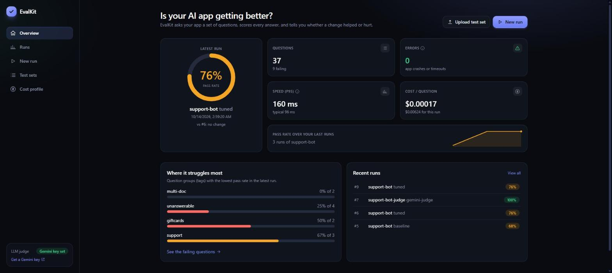
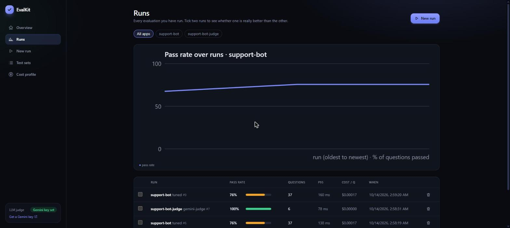
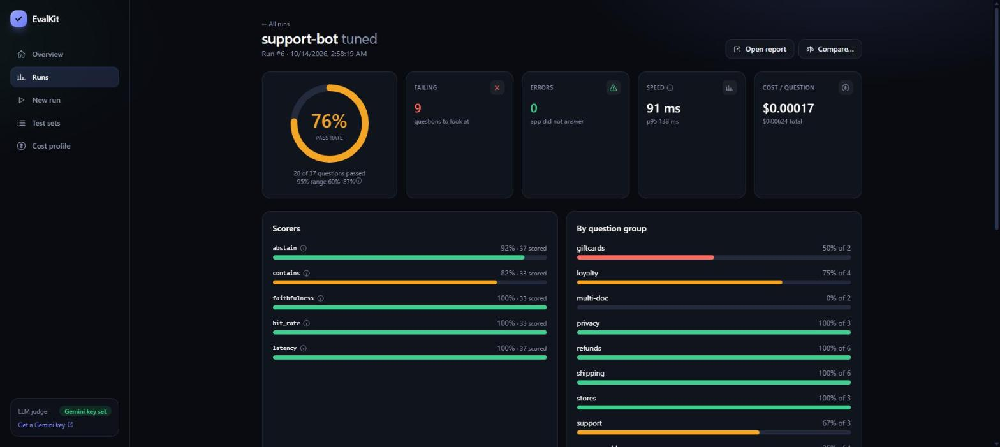
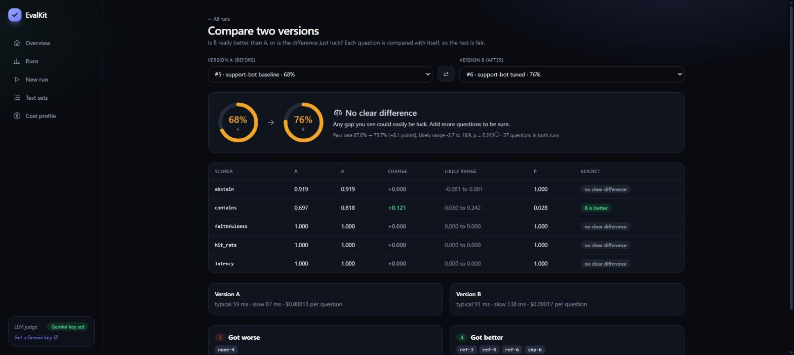
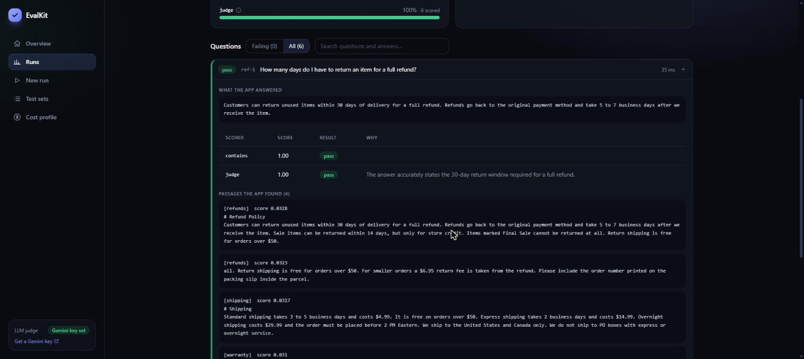
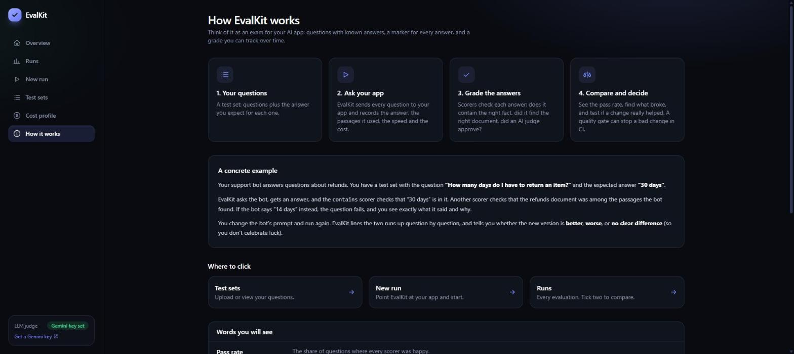
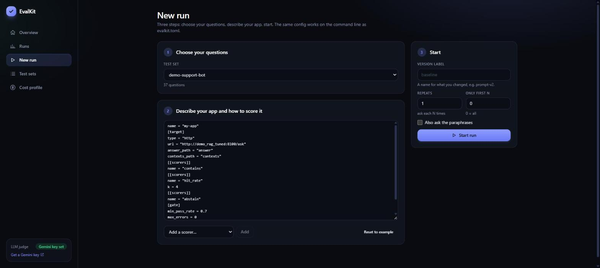
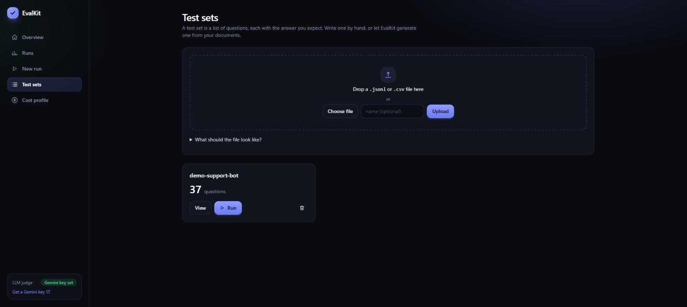

# EvalKit

**A test suite for AI apps.** Point it at any app that answers questions (a document chatbot, a support bot, a classifier, a model API), give it a list of questions, and it tells you **how good the answers are**, **whether your last change made things better or worse**, and **when to stop a bad change from shipping**.



---

## What is this, in plain words?

Imagine you built a chatbot that answers questions about your company's documents. You change something, such as the prompt, the model, or how documents are split up. **Did the chatbot get better, or did you quietly break it?**

Without a tool, you try five questions by hand and say "looks fine". That doesn't scale, and it misses regressions.

EvalKit works like an **exam for your AI app**:

| In school | In EvalKit |
|---|---|
| A list of exam questions with the right answers | a **test set** |
| The student | your **app** (the "target") |
| A teacher marking each answer | **scorers** (rules, or an AI judge) |
| The final grade | the **pass rate** |
| "Did this student improve since last term?" | **compare two runs** with a fair statistical test |
| "You must score 70% to pass" | the **quality gate** (fails your build in CI) |

You don't need to change your app's code. EvalKit just sends it questions over HTTP (or calls a Python function) and looks at what comes back.

## How it works

```
                 ┌────────────────┐   1. asks each question   ┌──────────────┐
  your test set  │                │ ────────────────────────► │   your app   │
  (questions +   │    EvalKit     │ ◄──────────────────────── │ (RAG bot,    │
  right answers) │                │   2. answer + passages    │  chatbot...) │
 ───────────────►│                │      it used              └──────────────┘
                 │  3. scorers    │
                 │     grade each │   4. saved in one SQLite file
                 │     answer     │ ─────────────────────────► dashboard, reports,
                 └────────────────┘                            A/B tests, CI gate
```

1. **Ask:** every question in the test set is sent to your app (several at once).
2. **Collect:** EvalKit records the answer, the passages the app says it used, how long it took, and what it cost.
3. **Score:** each scorer gives each answer a verdict. Examples: *does the answer contain "30 days"?*, *was the right document among the top results?*, *did it say "I don't know" when it should?*, *does an AI judge think it is correct?*
4. **Report:** results go into one SQLite file. You see them on the dashboard, in an HTML report, or as an exit code in CI.

## What each page shows

**Overview** is your home page: the latest pass rate, the trend, and the question groups where the app struggles most. A getting-started checklist appears until you have run your first evaluation.



**Run detail** is one evaluation in full: every scorer, results per topic, and every failing question with the app's answer, the score reasons, and the passages it found.



**Compare** answers "is B really better than A, or is that luck?". Each question is compared with itself, and the verdict is *B is better*, *A is better*, or *no clear difference*. The last one is an honest answer, not a failure: it means you need more questions to be sure.



**The AI judge** is a language model that grades answers and explains why. Below, Gemini checks whether the app's answer matches the expected one. You can check how far to trust the judge with `evalkit calibrate`.



**How it works** is a plain-language guide built into the dashboard (the same ideas as this README, with a worked example and a glossary).



**New run** and **Test sets** are where you set things up: choose questions, describe your app, add scorers, press start. Progress is live.




## Try it in 3 minutes (Docker)

```bash
docker compose up -d --build
```

- Dashboard: **http://localhost:8800** (a 37-question demo test set is already loaded)
- Demo app A (baseline): http://localhost:8100, demo app B (tuned): http://localhost:8101

Then, in the dashboard:

1. **New run.** The demo app's address is pre-filled. Type the version label `baseline` and press **Start run**. Watch the live progress.
2. Change the URL in the config to `http://demo_rag_tuned:8100/ask`, label it `tuned`, and run again.
3. Open **Runs**, tick both runs, and press **Compare**. B scores a few points higher, but with only 37 questions EvalKit tells you that's not yet statistically clear, and shows which scorer (`contains`) did improve for real.
4. Open a failing question in **Run detail** to see what the app said and why it failed.

To test an app running on your own computer, use `http://host.docker.internal:<port>/...` as the URL.

### Without Docker

```bash
python -m venv .venv && .venv\Scripts\activate        # macOS/Linux: source .venv/bin/activate
pip install -e ".[dev]"
python -m uvicorn examples.demo_rag.app:app --port 8100     # the app to test (leave it running)
cd examples/demo_rag
evalkit run                      # asks 37 questions, scores them, saves the run, checks the gate
evalkit ui                       # dashboard on http://localhost:8800 (build it once: cd web && npm install && npm run build)
```

## What it can check

| Question you have | EvalKit feature |
|---|---|
| "Do I have test questions?" | **Test-set generator** reads your documents and writes question/answer pairs, including two-document and unanswerable ones |
| "Is my search finding the right document?" | **Retrieval scorecard:** hit rate, MRR, recall@k; `evalkit sweep` compares search methods and chunk sizes on your own data |
| "Are the answers correct?" | **Scorers:** exact, contains, regex, embedding similarity, classification (accuracy and F1), and an **LLM judge** |
| "Can I trust the LLM judge?" | **Judge calibration:** agreement and Cohen's kappa against a human's labels |
| "Is it making things up?" | **Hallucination check:** splits the answer into claims and checks each against the retrieved text |
| "Is version B really better?" | **A/B test:** paired bootstrap and exact McNemar test, with a 95% range and a plain verdict |
| "Did my change break something?" | **Regression gate:** `evalkit run` exits with code 1 when quality drops (use it in CI) |
| "Where did it get worse?" | **Dashboard:** pass rate over runs, failing questions, retrieved passages, per-topic results |
| "What does it cost?" | **Cost and speed profile:** the cheapest setup that is still good enough |
| "Does it give the same answer twice?" | **Consistency tester:** repeats and paraphrases, flags flaky questions |
| "Does it say 'I don't know' when it should?" | **Red-team set:** injection, leaks, pressure, false premises, off-topic; checks it declines (and does not over-refuse) |

## Words you will see (a mini glossary)

| Term | Meaning |
|---|---|
| **Test set** | Your list of questions, each with the answer you expect. One JSON object per line (or a CSV). |
| **Target** | The app being tested. EvalKit calls it over HTTP, or as a Python function. |
| **Run** | One full pass of the test set through the app. Every run is saved, so you can compare them later. |
| **Scorer** | A small checker that grades one answer. You pick which ones to use. `evalkit scorers` lists them all. |
| **Pass rate** | The share of questions where every scorer was happy. |
| **95% range** | With few questions, the true pass rate could be a bit higher or lower. This is the believable range. More questions make it narrower. |
| **RAG** | "Retrieval-augmented generation": the app first *finds* relevant passages in your documents, then *writes* an answer from them. |
| **Hit rate / MRR / recall** | Retrieval scores: was a right document in the top results (hit rate), how high did it rank (MRR), how many of the right documents were found (recall). |
| **Faithfulness / hallucination** | Does the answer only say things the retrieved passages support? Unsupported claims are made-up facts. |
| **Abstain** | Saying "I don't know" when the documents have no answer. A good app abstains correctly and does not over-refuse. |
| **LLM judge** | A language model that grades answers against a rubric and explains why. Useful, but it needs checking (see `calibrate`). |
| **A/B test, p-value** | "Is the difference real?" p is the chance of seeing a gap this big by luck alone. Below 0.05 is usually called real. |
| **Quality gate** | Rules like "pass rate at least 70% and no regression". If they fail, `evalkit run` exits with 1 and your CI build fails. |
| **p50 / p95** | Typical (p50) and slow-case (p95) answer time. p95 = 95 of 100 answers were at least this fast. |

## Gemini API key (optional)

Most of EvalKit works offline. The **LLM judge**, the **hallucination check in `llm` mode**, the **test-set generator** and **Gemini embeddings** need a Gemini key.

1. Create a free key at **https://aistudio.google.com/apikey** (sign in with a Google account, click **Create API key**).
2. Give it to EvalKit through the `GEMINI_API_KEY` environment variable. The key is never written into config files, runs or reports.

| Where you run EvalKit | How to set the key |
|---|---|
| Docker | copy `.env.example` to `.env`, put the key in it, then `docker compose up -d --build` |
| Windows PowerShell | `$env:GEMINI_API_KEY = "your-key"` |
| macOS / Linux / Git Bash | `export GEMINI_API_KEY="your-key"` |

3. Turn the judge on in `evalkit.toml`:

```toml
[llm]
type = "gemini"
model = "gemini-flash-lite-latest"        # any Gemini model name
# fallback_models = ["gemini-flash-latest"]   # tried when a model's daily quota runs out

[[scorers]]
name = "judge"
criteria = ["correctness", "completeness"]

[[scorers]]
name = "faithfulness"                     # "llm" mode (the default) checks claim by claim
```

**Free-tier limits (important).** A free Gemini key allows only about **20 requests per day per model**. EvalKit helps in three ways:

- **Answers are cached** on disk (`<db>.llmcache`), so running the same evaluation again costs no quota.
- If a model's daily quota is used up, EvalKit **stops immediately** with a clear message (and how long until it resets), instead of retrying for minutes. The run still finishes; the dashboard shows a warning that some scores could not be calculated.
- `fallback_models` lets it switch to another model automatically. Every model has its own daily quota.

Judging 37 questions with 2 judge scorers needs about 74 calls, so for bigger test sets enable billing, or use `--limit` while you experiment.

## Connect any app (no adapter to write)

EvalKit works out how to talk to your app. Open **Connect app** in the dashboard, or use `evalkit connect`. It sends one real test question, shows what came back, finds where the answer is, and gives you the `[target]` settings to use.

| Your app is... | What to do |
|---|---|
| a service like OpenAI, Claude, Gemini, Ollama, Groq, OpenRouter | `preset = "openai"` (plus `model`). Keys come from environment variables. |
| any API with a JSON reply, in any shape | `answer_path = "auto"`. EvalKit finds the answer, the retrieved passages (`contexts_path = "auto"`) and token counts (`tokens_in_path = "auto"`) itself. |
| something you have a `curl` command for (docs, Postman, browser Network tab) | `evalkit connect --curl "curl ..."`. Keys are swapped for `${ENV_VAR}` names, never saved. |
| streaming (server-sent events or one JSON per line) | `stream = true` |
| a form, or a file upload (a PDF, an image) | `content_type = "form"` or `"multipart"` with `files = { resume = "{{input}}" }` |
| a website with a login and HTML pages (like a Django app) | `type = "web"`: `login`, `csrf = true`, `setup` steps, and `answer_selector = ".reply"` to read the answer from the page |
| Python code, even returning objects | `type = "python"`, `function = "pkg.mod:fn"`, and say where things are: `answer_key`, `contexts_key`, `django_settings` |

```bash
evalkit connect --preset gemini --model gemini-flash-lite-latest -q "What is a refund?"
evalkit connect --curl @request.txt --write evalkit.toml
```

**Testing a database-backed app:** point EvalKit at a **copy** of the data (a dump restored into a separate test database or container), never your live database. Evaluations can trigger writes (chat history, logs), and a copy also keeps the results repeatable.

```bash
evalkit snapshot ./app.db ./app_eval.db                     # SQLite: a consistent copy, even while the app runs
evalkit snapshot ./uploads ./uploads_eval                   # a folder of files
evalkit snapshot postgresql://user:pw@localhost:5432/mydb mydb_eval                       # Postgres: dump, then restore into a NEW database
evalkit snapshot postgresql://user:pw@localhost:5432/mydb mydb_eval --docker-container my-postgres   # no pg tools installed? use the container's
```

`snapshot` only ever reads the original, refuses to overwrite anything that exists, and prints the address of the copy to point your app at.

**Tried on real apps:** the same connection settings were used on four other projects (a LangGraph agent, a knowledge-graph chat, a streaming chatbot, a retrieval service). The ready-made configs are in `examples/own_projects/`. Two placeholders help with apps like these: `{{uuid}}` gives every question its own conversation id, and a setup step with `path = "id"` keeps a field (such as a new chat id) from a JSON reply.

## Use it on your own app

1. **Write `evalkit.toml`** (see `examples/demo_rag/evalkit.toml`):

```toml
name = "my-app"
testset = "questions.jsonl"

[target]
type = "http"                       # or: type = "python", function = "my_app.rag:answer"
url = "http://localhost:8000/ask"
body = { question = "{{input}}" }   # {{input}} is replaced by each question
answer_path = "answer"              # where the answer is in the JSON reply
contexts_path = "contexts"          # optional: retrieved passages

[[scorers]]
name = "contains"
[[scorers]]
name = "hit_rate"
k = 4
[[scorers]]
name = "abstain"

[gate]
min_pass_rate = 0.80
max_regression = 0.03               # fail if pass rate drops by more than 3 points vs the last run
```

2. **Write a test set** (`questions.jsonl`, one question per line), or generate one:

```json
{"id": "q1", "input": "How long do refunds take?", "expected": "5 to 7 business days", "relevant": ["refunds"]}
{"id": "q2", "input": "Do you sell tents on the moon?", "should_abstain": true}
```

```bash
evalkit generate docs/ -o questions.jsonl --multi-doc 5 --paraphrases 2 --redteam   # needs GEMINI_API_KEY
```

3. **Run it:** `evalkit run`. Exit code `0` = fine, `1` = the quality gate failed, `2` = misconfigured.

### Commands

| Command | What it does |
|---|---|
| `evalkit run` | ask every question, score, save, compare with the previous run, check the gate |
| `evalkit runs` / `show [ID] [--failing]` | list runs / show one |
| `evalkit compare A B [--html]` | A/B test two runs |
| `evalkit profile` | cheapest setup that is still good enough |
| `evalkit consistency [ID]` | how stable are answers across repeats and paraphrases (`run --repeats 3` or `--paraphrases` first) |
| `evalkit generate DOCS` | make a test set from documents (LLM) |
| `evalkit redteam` | write the built-in tricky-question set |
| `evalkit sweep DOCS -t testset` | retrieval scorecard: search method x chunk size |
| `evalkit calibrate labels.csv` | check the LLM judge against human labels |
| `evalkit scorers` | list all scorers |
| `evalkit import-testset FILE` / `testsets` | store test sets for the dashboard |
| `evalkit ui` | the dashboard |

### Scorers

`exact`, `contains`, `regex`, `similarity`, `hit_rate`, `mrr`, `recall`, `classification`, `latency`, `cost`, `abstain`, `judge`, `faithfulness`. Run `evalkit scorers` for details. Add your own with `@register` (see `evalkit/scorers/rules.py`; a scorer is one small class).

## In CI

`.github/workflows/ci.yml` runs the tests, then starts the demo app and runs `evalkit run`. The build fails if the quality gate fails, and the HTML report is uploaded as an artifact. Replace the demo app with yours.

## Why the statistics are the way they are

- A 5-point jump on 37 questions is usually noise. The A/B test is **paired** (each question is compared with itself) and reports a bootstrap 95% range and a p-value, so "no clear difference" is a real answer, not a failure. In the demo the overall pass rate change is not significant (p=0.24), but the `contains` scorer alone is (p=0.03). Both facts are shown.
- The regression gate only fails on drops that are statistically clear (`require_significant = false` to be strict).
- Pass rates come with a Wilson 95% interval, which stays honest even with few questions.
- Judge agreement uses Cohen's kappa (agreement corrected for chance), not a raw percentage.

## How it is built

Python 3.12, FastAPI, httpx, Typer, SQLite (every run, result and test set in one file). Dashboard: React, TypeScript, Tailwind, Vite. Gemini is called over plain HTTP (no SDK), and the key is only read from `GEMINI_API_KEY`. Everything except the judge, the generator and Gemini embeddings works offline (a built-in hashing embedder and a lexical faithfulness check are the fallbacks).

```
evalkit/core        models, storage, config, runner, summary, gate, reports
evalkit/targets     http and python targets
evalkit/scorers     rules.py (no model) and judge.py (LLM)
evalkit/llm         Gemini client, answer cache, offline embedder
evalkit/analysis    compare, consistency, profile, calibrate, stats
evalkit/retrieval   chunking, BM25, embeddings, hybrid search, sweep
evalkit/gen         test-set generator, red-team set
evalkit/api         dashboard API (FastAPI + WebSocket)
web/                dashboard
examples/demo_rag   the app to practise on
```

## Tests

```bash
pytest -q        # 121 tests, no network needed
ruff check .
```
